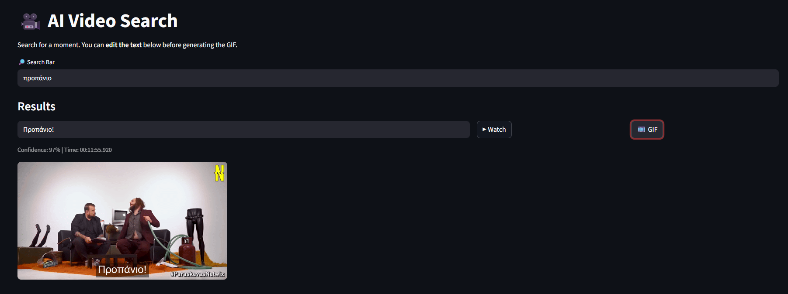
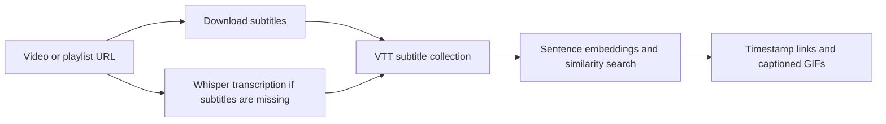

# Gif-Subs — semantic video search and GIF creation

Find moments in videos by searching subtitle embeddings, then create short captioned GIFs from the matching timestamps. The project combines subtitle downloading, Greek speech transcription and a Streamlit interface.



## Pipeline



The search model is `all-MiniLM-L6-v2`. The downloader uses the Faster-Whisper `small` model on CPU with int8 computation when transcription is needed. The transcription language is configured as Greek.

## Setup

Use Python 3 in a virtual environment:

```bash
python -m pip install streamlit webvtt-py sentence-transformers yt-dlp faster-whisper
```

FFmpeg is also required. The current download configuration expects its executables in the project directory; GIF creation invokes `ffmpeg` by name, so make it available on your PATH as well. The caption renderer uses Windows Arial at `C:/Windows/Fonts/arial.ttf`; adapt that path on other platforms.

The downloader reads cookies from a local Firefox profile. Model downloads require internet on first use. Dependencies are not pinned to a tested environment.

## Run

```bash
python download_subs.py
```

Enter a video or playlist URL when prompted. Then start the interface:

```bash
python -m streamlit run app.py
```

Search for a phrase, open the timestamped video result, or edit the caption and generate a GIF. Restart the app or clear its cache after adding subtitles if new entries do not appear.

## Files and limitations

- `download_subs.py`: downloads subtitles or transcribes audio.
- `app.py`: indexing, similarity search and GIF creation.
- `subs/`: VTT inputs.
- `gifs/`: generated clips.

The displayed similarity score is not a calibrated probability. Greek search quality has not been benchmarked here, and video availability, cookies and download-service changes can affect the workflow. Use media you are permitted to download and reuse.
